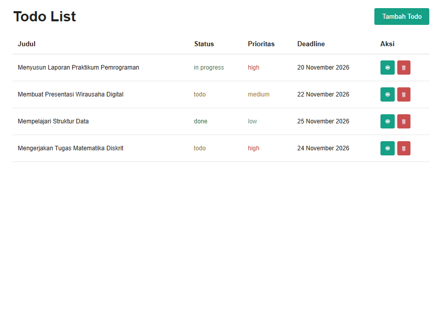
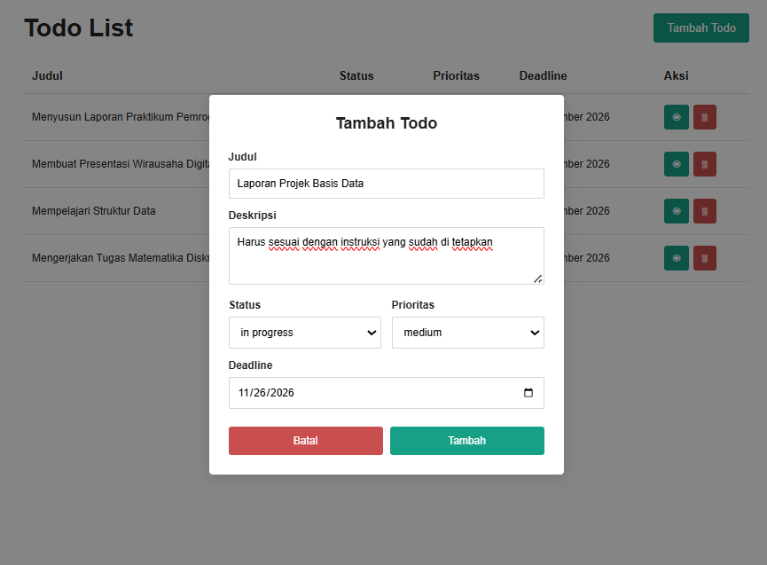
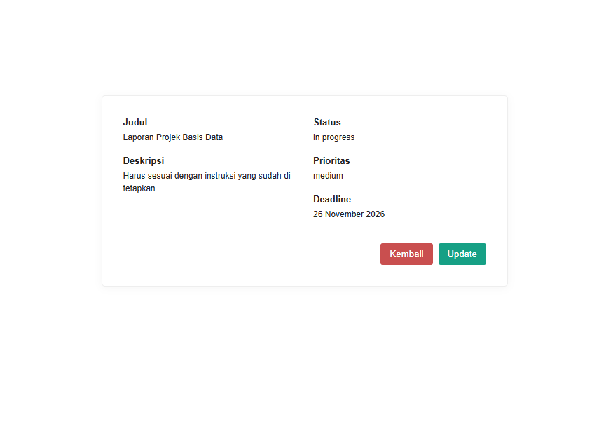
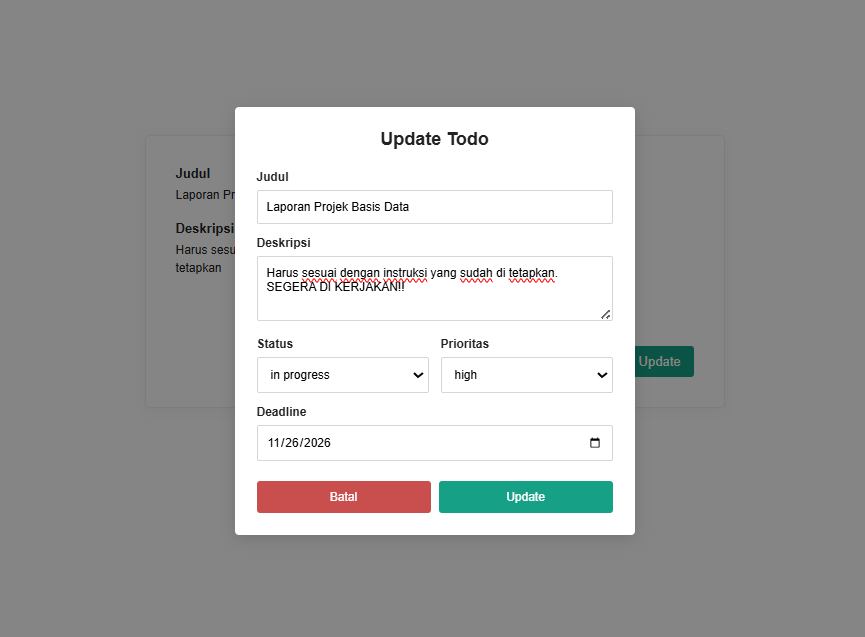
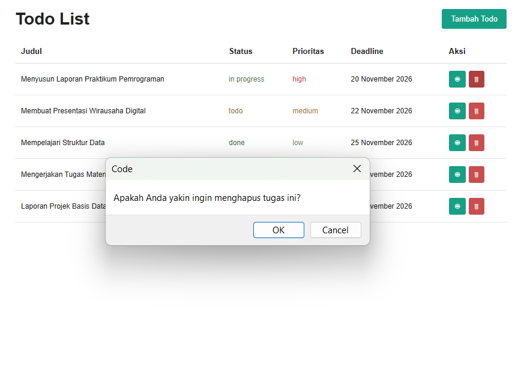

# Aplikasi To-Do List

## Deskripsi
Aplikasi To-Do List adalah aplikasi berbasis web yang dibuat menggunakan React.js. Aplikasi ini membantu pengguna mencatat dan mengatur tugas agar lebih mudah dikelola.

## Fitur
1. **Tambah Tugas:** Menambahkan tugas baru.
2. **Detail Tugas:** Melihat informasi tugas.
3. **Edit Tugas:** Mengubah informasi tugas.
4. **Hapus Tugas:** Menghapus tugas.
5. **Status Tugas:** Mengetahui apakah tugas belum dikerjakan, sedang dikerjakan, atau sudah selesai.
6. **Prioritas:** Menentukan tingkat kepentingan tugas.
7. **Deadline:** Menentukan batas waktu pengerjaan tugas.

## Dokumentasi Aplikasi

### 1. Tampilan Utama

### 2. Tambah Tugas

### 3. Detail Tugas

### 4. Edit Tugas

### 5. Hapus Tugas
